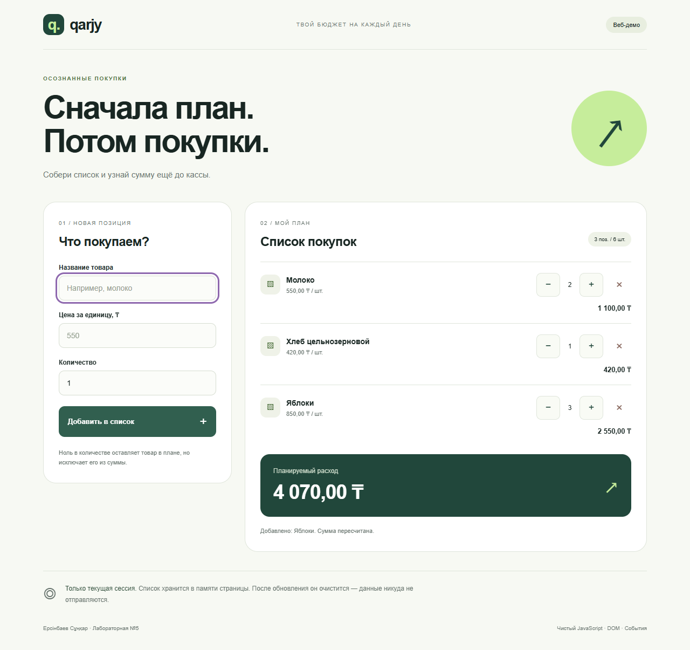

# Qarjy — dom-store-ersinbaev

**Ерсінбаев Сұңқар. Лабораторная №5: DOM, события, формы.**

Веб-демо планирования расходов на покупки. Товары представлены как `{ name, price, qty }`, как требует условие. Список начинается пустым, без подставленных покупок.

## Как открыть

Распаковать всю папку и открыть `index.html` двойным щелчком в современном браузере. Сборка, сервер, npm и подключение к интернету не нужны. Не перемещать `index.html` отдельно от `src/`, `style.css` и `icon.svg`.

## Что делает страница

1. Ввести название, цену за единицу в тенге и целое количество.
2. Нажать «Добавить в список»; сумма считается сразу.
3. Кнопки `+` и `−` меняют количество, `×` удаляет товар.
4. Нулевое количество разрешено, кнопка уменьшения на нуле отключается.
5. Повтор имени отклоняется: количество существующего товара меняется кнопками.

Пустое имя, нулевая/отрицательная/нечисловая цена, дробное/отрицательное/нечисловое количество показывают ошибки **рядом с полем**, без alert. Цена — от 0,01 до 1 000 000 000 ₸, до двух знаков после запятой; количество — от 0 до 1 000 000. Пользовательский текст выводится через `textContent`.

Состояние хранится в памяти экземпляра `Store`; после обновления страницы список очищается. Постоянное сохранение и банковские подключения не входят в задание.

## Какие события и почему

На форме обрабатывается `submit`, чтобы добавление работало и кнопкой, и клавишей Enter, а `preventDefault()` предотвращает перезагрузку. Перед изменением Store проверяются значения, ошибки записываются в DOM и первое ошибочное поле получает фокус. На контейнере списка установлен один делегированный обработчик `click`, который через `closest('button[data-action]')` различает увеличение, уменьшение и удаление. Поэтому динамически созданным строкам не нужны отдельные обработчики, а после любой операции достаточно вызвать `render()` и обновить сумму. Сообщение `role="status"` сообщает об изменении, а фокус после перерисовки возвращается на подходящую кнопку или в форму.

## Структура

- `src/Store.js` — тот же код классов из №4, только без `export`, чтобы обычный script работал при открытии `index.html` через `file://`.
- `src/app.js` — рендер, форма, ошибки и делегирование событий.
- `style.css` — оформление без фреймворков, адаптация под телефон и компьютер.
- `screenshots/` — реальные снимки страницы после добавления трёх товаров. Эти товары не загружаются в приложение автоматически.

## Скриншот

Дополнительно: [375 px](screenshots/375.png), [768 px](screenshots/768.png).

## Проверки

В Chromium проверены добавление, удаление последней строки, `+`/`−`, итог без перезагрузки, ошибки пустых/неправильных значений и повторного имени, безопасный вывод HTML-подобного ввода, сброс после обновления и открытие через `file://`. На 320, 375, 600, 768, 1024 и 1280 px нет горизонтальной прокрутки. Код модели Store также покрыт тестами в лабораторной №4.

## AI и сдача

Использован OpenAI Codex (ChatGPT) для кода, дизайна, проверок и черновика пояснений. Перед защитой нужно изучить код и пересказать объяснение событий своими словами. Публикация на собственном GitHub, минимум три содержательных коммита и отправка преподавателю пока не выполнены. GitHub Pages для №5 необязателен по скриншоту задания.
