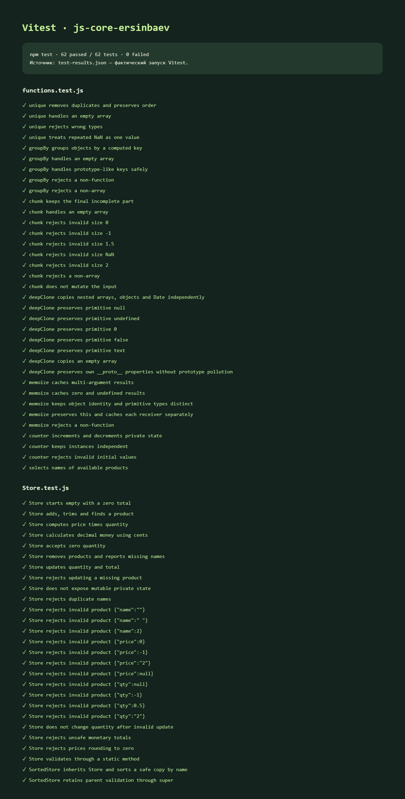

# js-core-ersinbaev — лабораторная №4

**Ерсінбаев Сұңқар. JavaScript: функции, замыкания, классы, unit tests.**

## Запуск тестов

Нужен Node.js 22.12+ (проверено на Node 24.11.1). В папке проекта:

```sh
npm i
npm test
```

`npm test` запускает Vitest один раз и завершается; `npm run test:watch` включает наблюдение за изменениями. Файл `package-lock.json` фиксирует установленные версии; для точного повторения установки можно использовать `npm ci`.

## Функции — src/functions.js

| Функция | Поведение |
| --- | --- |
| `unique(arr)` | Убирает повторы, сохраняет порядок первых вхождений. Объекты сравниваются по ссылке |
| `groupBy(arr, keyFn)` | Группирует элементы по вычисляемому ключу, возвращает объект без прототипа для безопасных ключей |
| `chunk(arr, size)` | Делит массив на новые части, последняя может быть короче; size — положительное целое |
| `deepClone(obj)` | Рекурсивно копирует обычные объекты, массивы, Date; не использует JSON для клонирования |
| `memoize(fn)` | Запоминает результаты по аргументам и контексту this; замыкание хранит дерево Map |
| `counter(initial = 0)` | Возвращает `inc()`, `dec()`, `value()`, работающие с одной закрытой переменной |
| `inStockNames(items)` | Дополнительный пример filter + map с деструктуризацией |

У `deepClone` циклические ссылки, Map, Set и другие специальные типы не входят в контракт. У `memoize` объектные аргументы сравниваются по ссылке: изменение уже переданного объекта не сбрасывает кеш. Для кеширования предполагаются функции со стабильным результатом при одинаковых входах.

## Классы — src/Store.js

Товар: `{ name, price, qty }`. Имя непустое и уникальное после trim, цена положительная, количество — неотрицательное целое. Нулевое количество разрешено. Цена нормализуется до сотых; сумма считается в целых сотых, а выводится в денежных единицах.

- `add(item)` — проверяет и добавляет товар, возвращает копию добавленного товара.
- `remove(name)` — удаляет по имени, возвращает boolean.
- `find(name)` — возвращает копию или undefined.
- `total()` — сумма price × qty.
- `updateQty(name, qty)` — дополнительный метод для DOM-работы №5.
- `#items` — приватное поле; getter `items` возвращает копии.
- `Store.validate(item)` — static-метод проверки товара.
- `SortedStore extends Store` — переопределяет getter `items`, сортируя копию по имени; переопределённый `add` вызывает `super.add` и возвращает отсортированный список.

```js
import { SortedStore } from './src/Store.js';
const store = new SortedStore();
store.add({ name: 'Молоко', price: 550, qty: 2 });
console.log(store.total()); // 1100
```

## Closures in my code

Замыкание позволяет возвращённой функции обращаться к переменным того вызова, в котором она была создана. В `counter` функции `inc`, `dec` и `value` используют одну переменную `current`, хотя вызов фабрики уже завершился. Значение нельзя изменить напрямую снаружи, потому что возвращённый объект содержит только функции доступа к нему. Каждый новый вызов `counter()` создаёт собственную переменную, поэтому два счётчика независимы. В `memoize` возвращённая функция замыкает `cache` и `resultKey`, сохраняя результаты между вызовами. Дерево `Map` различает наборы аргументов, типы значений, ссылки на объекты и контекст `this`, а `has` позволяет кешировать даже результат `undefined`. Таким образом, замыкания здесь сохраняют состояние без глобальных переменных: у счётчика это число, а у мемоизации — кеш.

## Результат тестов

**62 теста прошли**, два файла тестов. Проверены функции, замыкания, независимость состояний, аргументы неверного типа, пустые массивы, нули, Date, денежная точность, приватность Store, наследование и валидация. Тесты написаны на Vitest; lodash не используется.



Данные отчёта: [test-results.json](screenshots/test-results.json). Скриншот снят с [HTML-отчёта](screenshots/test-report.html), сформированного из фактического JSON-вывода. Чтобы повторно получить JSON:

```sh
npm test -- --reporter=default --reporter=json --outputFile=screenshots/test-results.json
```

## AI и защита

Использован OpenAI Codex (ChatGPT) для реализации, тестов, проверки и черновика пояснений. Код и текст нужно изучить и объяснить своими словами. Готовая библиотека функций не копировалась. Публичный репозиторий, минимум три осмысленных коммита и собственная видеозащита пока не подготовлены; они не подменяются локальными файлами.
