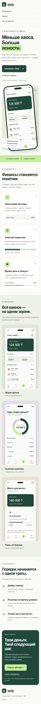
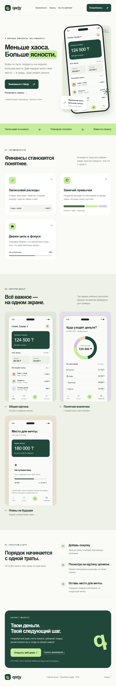
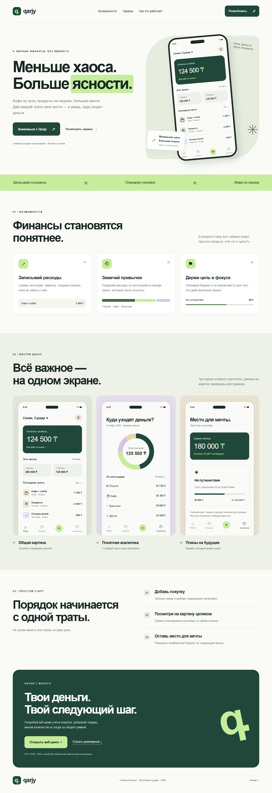

# Qarjy — landing-ersinbaev

**Ерсінбаев Сұңқар. Лабораторные №2–3. Трек D: Modern plain CSS.**

Лендинг учебного концепта мобильного приложения для учёта расходов: возможности, три экрана интерфейса, порядок работы и скачивание веб-демо. Нативного APK/IPA нет; вместо вымышленной ссылки в магазин доступен настоящий ZIP с работающим локальным демо планирования покупок из №5.

## Запуск

Открыть `index.html` в современном браузере. Сборка, npm и сервер не нужны. Изображения, стили и ZIP локальные. Ссылка «Открыть веб-демо» работает, когда папка `dom-store-ersinbaev` лежит рядом; для самостоятельного лендинга можно скачать ZIP в любом случае.

## Структура

- `index.html` — семантические header, nav, main, section, article, figure, footer.
- `style.css` — обычный CSS, без Sass и фреймворков.
- `assets/` — значок и PNG трёх экранов.
- `previews/` — исходные HTML/CSS-макеты, с которых сняты PNG. Это иллюстрации, а не мобильная сборка.
- `downloads/qarjy-web-demo.zip` — демоверсия, распаковать и открыть index.html.
- `screenshots/` — страница на трёх обязательных ширинах.

## Responsive

До 600 px включительно меню расположено вертикально, карточки идут в одну колонку. От 601 до 1023 px карточки занимают две колонки. Начиная с 1024 px — три. Grid использует `minmax(0, 1fr)`, изображения ограничены шириной контейнера; горизонтальная прокрутка не маскируется через `overflow-x: hidden`.

### 375 px

### 768 px

### 1280 px

## Why this tool

Современный чистый CSS подходит этому лендингу, потому что для него не нужна сборка или библиотека компонентов. Переменные в `:root` задают общие цвета, радиус и шрифт, поэтому оформление меняется в одном месте. Нативная вложенность группирует состояния кнопки и стили содержимого карточки, выполняя здесь роль вложенности Sass. Функция `clamp()` плавно меняет размеры заголовков между заданными пределами вместо набора отдельных медиазапросов для каждого размера текста. Селектор `:has()` меняет цвет подписи всей карточки экрана при наведении на изображение, позволяя связать состояние родителя с его содержимым без JavaScript. В отличие от Tailwind и Bootstrap, этот подход требует самостоятельно писать классы, сетку и правила адаптивности. Он удобен для небольшой самостоятельной страницы, но совместимость новых возможностей нужно проверять, а готовых компонентов, как у Bootstrap, здесь нет.

Справка: [MDN — CSS nesting](https://developer.mozilla.org/en-US/docs/Web/CSS/Guides/Nesting), [MDN — clamp()](https://developer.mozilla.org/en-US/docs/Web/CSS/clamp), [MDN — :has()](https://developer.mozilla.org/en-US/docs/Web/CSS/:has).

## Проверка

В Chromium проверены ширины 320, 375, 600, 601, 768, 1023, 1024, 1280 и 1920 px: горизонтальной прокрутки нет, сетка меняется на 1/2/3 колонки. Изображения загружаются, якоря ведут к существующим секциям, ZIP скачивается. Собственного JavaScript на лендинге нет. Мобильная навигация намеренно вертикальная: бургер не требуется по условию.

## AI

Использован OpenAI Codex (ChatGPT): код, визуальное оформление, макеты экранов, проверки и черновик пояснения. Перед защитой раздел `Why this tool` нужно понять и пересказать своими словами. Готовые шаблоны и чужие репозитории не использовались.

## Публикация и сдача

GitHub и Pages пока не настроены. Полное отдельное условие №2 не было передано: эта версия реализует известную тему и требования №3. Минимум три осмысленных коммита, заполнение своей строки таблицы и ответ преподавателю пока остаются отдельными шагами.
